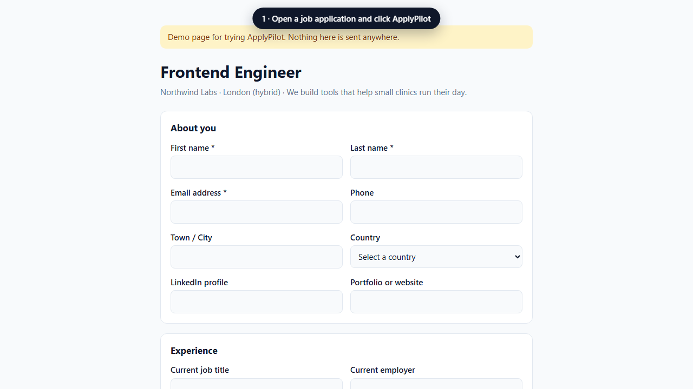
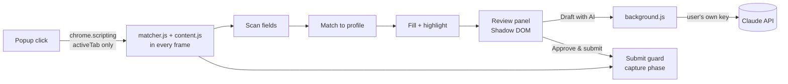

<div align="center">


# ApplyPilot

**Fills your job applications. Waits for your approval.**

A Chrome extension that fills application forms from your profile, highlights every answer it gives, and holds the Submit button until you've checked them.

[](https://github.com/jossy450/applypilot/actions/workflows/ci.yml)
[](https://github.com/jossy450/applypilot/releases/latest)


[](LICENSE)

[**Download**](https://github.com/jossy450/applypilot/releases/latest) · [**Try the demo form**](https://jossy450.github.io/applypilot/) · [How it works](#how-it-works) · [Privacy](#privacy)



</div>

## Why

Job seekers type the same name, email, LinkedIn URL and "Are you authorized to work…?" answers into hundreds of forms. Most autofill tools take over completely and send applications nobody read. ApplyPilot does the typing and leaves every decision to you:

| | |
|---|---|
| 🖱️ **You start it** | It runs only when you click the toolbar icon (or press <kbd>Alt</kbd>+<kbd>Shift</kbd>+<kbd>A</kbd>). It can't see any site until then. |
| 👀 **You see everything** | Every field it touches gets a colored outline, and a side panel lists each answer. Click a row to jump to that field. |
| ✅ **You approve the submit** | Submit buttons stay locked until you tick *"I've checked every field"* and press **Approve & submit**. |

## Features

- **Smart field matching**: uses `autocomplete` attributes, `<label>`s, `aria-label`s, fieldset legends, placeholders and `name`/`id` attributes. Fills text inputs, `<select>` menus (it knows "UK" means "United Kingdom") and yes/no radio groups.
- **Framework-safe filling**: sets values through the native setter and fires `input`/`change` events, so React, Vue and Angular forms register them.
- **A review panel that tells the truth**: fields are grouped as *Filled*, *Check this*, *Needs you*, *Upload yourself* and *Left for you*. Anything you change afterwards is marked *Edited by you*. If required fields are still empty when you approve, it says so instead of claiming the form was sent.
- **Saved answers**: store answers to the questions you get asked often. When a form asks something similar, ApplyPilot reuses your answer and marks it for you to check.
- **AI drafts for open questions (optional)**: "Why do you want to work here?" can be drafted with Claude, using your profile, CV and the job page. The model is told never to invent facts and to write `[ADD: …]` wherever it lacks information.
- **Respects boundaries**: it never fills gender, ethnicity, disability, veteran status, date of birth, ID numbers, passwords or consent boxes. It never attaches files, so you always choose which CV goes out.
- **Portable**: export and import your profile as JSON. The API key is never included in the export.

## Install

**From a release (recommended)**

1. Download `applypilot-vX.Y.Z.zip` from the [latest release](https://github.com/jossy450/applypilot/releases/latest) and unzip it.
2. Open `chrome://extensions`, turn on **Developer mode**, click **Load unpacked** and pick the unzipped folder.
3. The settings page opens. Fill in your profile and click **Save**.
4. Open a job application, click the ApplyPilot icon, then **Fill & review this page**.

Try it first on the [demo application form](https://jossy450.github.io/applypilot/).

**From source:** clone the repo and load the folder the same way. There's no build step.

## How it works



| File | Role |
|---|---|
| [`src/matcher.js`](src/matcher.js) | Pure matching logic: label rules, autocomplete map, sensitive-field filter, option picking, saved-answer similarity. No DOM access, so it's unit-tested in Node. |
| [`src/content.js`](src/content.js) | Injected on demand. Resolves labels, fills fields, tracks your edits, renders the review panel and guards submission. |
| [`src/background.js`](src/background.js) | MV3 service worker. Calls the Claude Messages API for drafts and handles refusals, rate limits and truncation. |
| [`popup/`](popup) · [`options/`](options) | Toolbar popup, and the profile & settings page. |

### Engineering notes

- **Least privilege.** `activeTab` + `scripting` instead of content scripts on `<all_urls>`, so the extension can't read pages you haven't invoked it on. The only host permission is `api.anthropic.com`.
- **Works on hostile pages.** The panel lives in a Shadow DOM and uses constructable stylesheets, so a site's CSS can't break it and a strict Content-Security-Policy can't block its styles.
- **Rule order is part of the logic.** Question patterns run before location patterns, so "authorized to work in the United *States*" isn't read as a *State* field. The unit tests pin these edge cases.
- **Interception without breaking the page.** Submit and click events are caught in the capture phase on `window`, before React's root listener sees them, and released only after you approve.
- **Tested in a real browser.** Playwright loads the unpacked extension in Chromium and runs the whole flow (fill → blocked submit → AI draft → edit tracking → approve → submit) on every push. The animation above is recorded by [`scripts/record-demo.js`](scripts/record-demo.js) from that same flow.
- **No dependencies at runtime.** Plain JavaScript that Chrome loads directly. Even the icons and the animated PNG are written by a tiny PNG encoder in [`scripts/png.js`](scripts/png.js).

## Privacy

- Your profile, saved answers and API key are stored in `chrome.storage.local`, on your computer only.
- Nothing leaves your browser unless you click **Draft with AI**. Then the question, your profile, your CV text and the job page's text are sent to Anthropic's API using your own key.
- No analytics, no tracking, and no servers of our own.

## Development

```bash
npm install
npx playwright install chromium   # once
npm test                          # unit tests for the matcher
npm run test:e2e                  # full flow in Chromium with the real extension loaded
npm run demo                      # serve the demo form at http://localhost:5173
npm run demo:record               # re-record docs/demo.png
npm run icons                     # regenerate icons/
```

To release: bump `version` in `manifest.json`, then push a matching tag (`git tag v1.1.0 && git push --tags`). GitHub Actions runs the tests, zips the extension and publishes the release.

## Roadmap

- [ ] Multi-step forms (Workday, SuccessFactors): carry the review across pages
- [ ] Remember corrections per site
- [ ] Cover-letter drafting from the job description
- [ ] Chrome Web Store listing
- [ ] Firefox port

## License

[MIT](LICENSE) © jossy450
