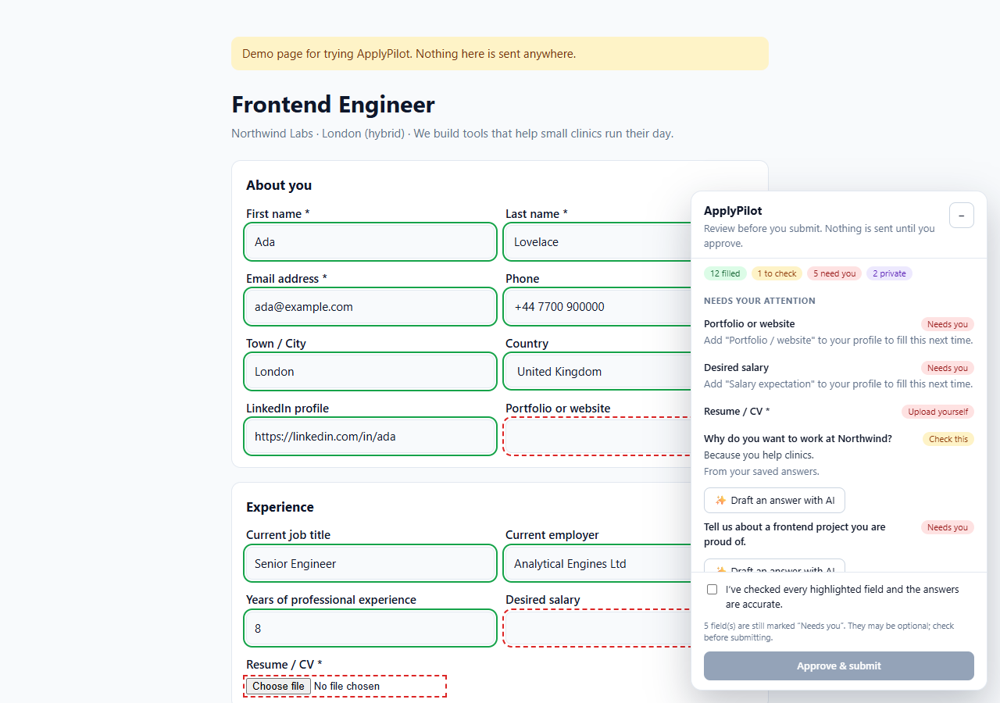

# ApplyPilot

**A Chrome extension that fills job applications for you and then waits.** It fills in what it knows, highlights every answer, and won't let the form submit until you've reviewed it and clicked **Approve**.



## Why

Job seekers type the same name, email, LinkedIn URL and "Are you authorized to work…?" answers into hundreds of forms. Most autofill tools take this over completely and submit applications nobody has read. ApplyPilot takes the opposite approach and keeps you in charge:

- **You start it.** It runs only when you click the toolbar button (or press <kbd>Alt</kbd>+<kbd>Shift</kbd>+<kbd>A</kbd>). It has no access to any site until then.
- **You see everything.** Each field it touches gets a colored outline, and a side panel lists every answer it gave.
- **You approve the submit.** Submit buttons and form submissions are held until you tick "I've checked every field" and press **Approve & submit**.

## Features

| | |
|---|---|
| **Smart field matching** | Reads `autocomplete` attributes, `<label>`s, `aria-label`s, fieldset legends, placeholders and `name`/`id` attributes, then maps each field to your profile. Handles text inputs, `<select>` menus (including "UK" → "United Kingdom") and yes/no radio groups. |
| **Works with modern frameworks** | Sets values through the native setter and fires `input`/`change` events, so React, Vue and Angular forms register the change. |
| **Review panel** | Groups fields into *Filled*, *Check this*, *Needs you*, *Upload yourself* and *Left for you*. Click any row to jump to that field. Fields you edit afterwards are marked *Edited by you*. |
| **Submit guard** | Intercepts submit events and clicks on Submit/Apply buttons until you approve. If required fields are still empty, it says so instead of claiming the form was sent. |
| **Saved answers** | Store answers to the questions you get asked often. A question with similar wording reuses your answer, marked for you to check. |
| **Optional AI drafts** | For open questions such as "Why do you want to work here?", draft an answer with Claude, grounded in your profile, CV and the job page. The model is told never to invent facts and to leave `[ADD: …]` placeholders where it lacks information. |
| **Respects boundaries** | Never touches gender, ethnicity, disability, veteran status, date of birth, ID numbers, passwords or consent checkboxes. File uploads stay with you, so you always choose which CV goes out. |
| **Portable profile** | Export and import your profile as JSON. The API key is never included in the export. |

## Install (developer mode)

1. Clone this repo.
2. Open `chrome://extensions`, turn on **Developer mode**, click **Load unpacked** and pick the repo folder.
3. The settings page opens. Fill in your profile and save.
4. Open any application form and click the ApplyPilot icon, then **Fill & review this page**.

Try it on the bundled demo form first:

```bash
npm run demo        # serves demo/ at http://localhost:5173
```

## How it works

```
popup ──(chrome.scripting, on click only)──▶ matcher.js + content.js in every frame
                                               │
                         scan fields ─▶ match ─▶ fill ─▶ highlight ─▶ review panel (Shadow DOM)
                                               │                         │
                                     submit guard (capture phase) ◀── Approve & submit
                                               │
                              "Draft with AI" ─▶ background.js ─▶ Claude Messages API
```

| File | Role |
|---|---|
| [`src/matcher.js`](src/matcher.js) | Pure matching logic: label rules, autocomplete map, sensitive-field filter, option picking, saved-answer similarity. No DOM, so it's unit-tested in Node. |
| [`src/content.js`](src/content.js) | Injected on demand. Finds labels, fills fields, tracks edits, renders the review panel in a Shadow DOM, and guards submission. |
| [`src/background.js`](src/background.js) | MV3 service worker. Calls the Claude API for drafts, using the user's own key. |
| [`popup/`](popup) · [`options/`](options) | Toolbar popup and the profile/settings page. |

Design choices worth noting:

- **`activeTab` + `scripting` instead of `<all_urls>` content scripts.** ApplyPilot can't read any page until you invoke it. The only host permission it requests is `api.anthropic.com`.
- **Shadow DOM and constructable stylesheets** keep the panel's styles and the site's styles apart, and work on sites with strict CSPs.
- **Order-sensitive rules.** Question patterns run before location patterns, so "authorized to work in the United *States*" isn't read as a *State* field.

## Privacy

- Your profile, saved answers and API key are stored in `chrome.storage.local`, on your machine only.
- Nothing leaves your browser unless you click **Draft with AI**. Then the question, your profile, your CV text and the visible text of the job page are sent to Anthropic's API using your own key.
- No analytics and no servers of our own.

## Development

```bash
npm install
npx playwright install chromium   # once, for the end-to-end tests
npm test                          # matcher unit tests (node:test)
npm run test:e2e                  # loads the extension in Chromium and runs the full review flow on the demo form
npm run icons                     # regenerate icons/ (dependency-free PNG writer)
```

There's no build step. The extension is plain JavaScript that Chrome loads directly.

## Roadmap

- Multi-step forms (Workday, SuccessFactors): carry the review panel across pages
- Per-site memory of answers you corrected
- Cover-letter drafting from the job description
- Firefox port

## License

[MIT](LICENSE)
